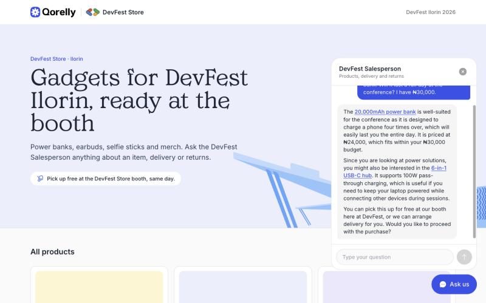

# DevFest Store: a Firebase AI Logic codelab

**Build an AI-powered customer support agent using Firebase AI Logic.** This is the
companion repo for the DevFest Ilorin 2026 workshop.

DevFest Store is a pop-up gadget shop at DevFest Ilorin, powered by Qorelly. The
**DevFest Salesperson** answers questions about products, booth pick-up, delivery
and returns. It runs on a **server prompt
template**, so the instructions and the confidential goodwill budget never reach
the browser.



> Nothing here is for sale. The products, prices and policies are sample data in
> `src/data/catalogue.json`.

---

## How it works

```
Browser ──App Check──▶ Firebase AI Logic ──▶ Gemini on Agent Platform
                        (product-agent template)        │
                                                        ▼
                                  catalogue.txt in Cloud Storage
                                  (read by the AI Logic service agent)
```

| Piece | Where |
|---|---|
| The one file the codelab edits | [`src/lib/firebase.ts`](src/lib/firebase.ts) |
| Config (never committed) | `.env.local`, from [`.env.example`](.env.example) |
| Prompt template (with input schema), test input, catalogue, Storage rules | [`firebase/`](firebase) |
| Store data | [`src/data/catalogue.json`](src/data/catalogue.json) |

---

> **You are on `step-1-starter`.** The store runs, and the chat answers with a
> placeholder. Set up Firebase with the checklist below, then switch to `main`
> (or follow the codelab) to connect the chat.

## The codelab in two steps

| Step | Branch | You will |
|---|---|---|
| 1 | `step-1-starter` | Run the store and set up Firebase. The chat isn't connected yet |
| 2 | `main` | Connect the chat to Firebase AI Logic and secure it with App Check |

---

## Quick start

Requires Node 20 or later.

```bash
git clone <this repo> devfest-ai-logic
cd devfest-ai-logic
npm install
cp .env.example .env.local   # fill this in during the codelab
npm run dev                  # http://localhost:5173
```

The store loads without any config. Until `.env.local` is filled in, the chat
replies with what to set up.

---

## Firebase setup checklist

1. Create a Firebase project (for example `devfest-store-ai`) and upgrade it to
   **Blaze**.
2. Register a web app and copy its config into `.env.local`.
3. **AI Logic → Get started → Agent Platform Gemini API.** Don't choose the Gemini
   Developer API, because it can't read files from Cloud Storage.
4. **Storage → Get started.** Use production mode. On the **Rules** tab, paste
   [`firebase/storage.rules`](firebase/storage.rules) and publish. AI Logic checks
   these rules before it reads a file, so without them the chat gets a 403. Then upload
   [`firebase/catalogue.txt`](firebase/catalogue.txt), or run `npm run catalogue:upload`
   (needs `gcloud auth login`).
5. In Cloud console, open your bucket, go to **Permissions → Grant access**, and grant
   `service-<PROJECT_NUMBER>@gcp-sa-firebasevertexai.iam.gserviceaccount.com`
   the **Storage Object Viewer** role.
6. **AI Logic → Prompt templates → Create.** Use the ID `product-agent`. From
   [`product-agent.prompt`](firebase/product-agent.prompt), paste the part between
   the `---` lines into **Configuration** (the model and input schema), and the rest
   into **Prompt**. Replace `YOUR_PROJECT_ID`. To test it, choose **Agent Platform**
   as the provider and use [`product-agent.test-input.json`](firebase/product-agent.test-input.json)
   as the test input. Then save.
7. **App Check:**
   - Create a reCAPTCHA key in Cloud console (Security → Fraud Defense).
   - Register the key under App Check → Apps.
   - Generate a debug token and add it to `.env.local`.
8. `npm run dev` and ask the assistant something.

---

## Troubleshooting

| You see | Cause | Fix |
|---|---|---|
| `AI/no-api-key` or "I'm not set up yet" | `.env.local` missing or not loaded | Fill it in and restart `npm run dev` |
| `exchangeDebugToken` 403 | Debug token not registered, or registered on another app | App Check → Apps → ⋮ → Manage debug tokens |
| 401 "App Check token is invalid" | Same as above | Same as above, then wait a minute (throttling) |
| `AI/api-not-enabled` | AI Logic not set up for this project | AI Logic → Get started → Agent Platform |
| 400 "Referencing Google Cloud Storage files directly is not supported" | Using the Gemini Developer API (`GoogleAIBackend`) | Use `AgentPlatformBackend` |
| 404 "Publisher model … was not found" | Model not served in the chosen location | Leave `AgentPlatformBackend()` on its default, `global` |
| 403 `storage.objects.get` | The AI Logic service agent can't read the bucket | Checklist step 5. Allow 1–2 minutes for the grant to take effect |
| 403 "The caller does not have permission" | Storage rules don't allow reading `catalogue.txt` | Publish [`firebase/storage.rules`](firebase/storage.rules) (checklist step 4) |

---

## Changing the products

Edit `src/data/catalogue.json`, then:

```bash
npm run catalogue          # rewrites firebase/catalogue.txt
npm run catalogue:upload   # rewrites it and uploads it to your bucket (gcloud)
```

The assistant reads the uploaded `catalogue.txt`, so upload it again after every
change, or it will describe products the store no longer shows.

---

## Clean up

Delete the App Check debug token, then delete the Firebase project, or downgrade
it to Spark.
